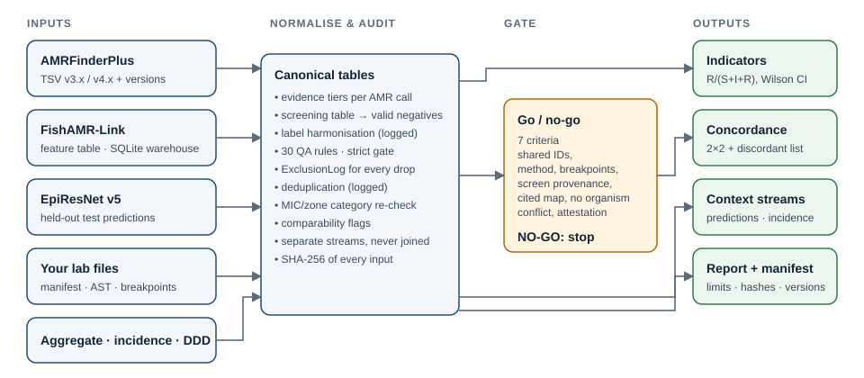

<div align="center">

# 🧬 AMR-Surveil

### Reproducible genomic & epidemiological surveillance of antimicrobial resistance

**An auditable analysis layer that connects AMR gene detection, phenotypic AST, surveillance context and model outputs — and tells you when you are *not* allowed to compare them.**

<p>
  <a href="https://github.com/MyMKGitH/amr-surveil/actions/workflows/ci.yml"></a>
  
  
  
  
  
  
  
  
</p>

[](https://doi.org/10.5281/zenodo.24224046)

**Author:** MK (Moad Khalifa) · [GitHub](https://github.com/MyMKGitH) · Builds on [FishAMR-Link](https://github.com/MyMKGitH) and [EpiResNet](https://github.com/MyMKGitH)

</div>

---

## Why this exists

Most AMR tools answer one question well. Surveillance fails in the gaps *between* them: a gene is called "absent" for a sample nobody sequenced; a resistance percentage is compared across years after the breakpoint version changed; a model's accuracy is reported on data it trained on. AMR-Surveil is the layer that makes those gaps visible and refuses to paper over them.

<div align="center">

</div>

## What is in 1.1.x

| Capability | What it does |
|---|---|
| **Screened-sample genotypes** | A *negative* gene result exists only for samples declared as screened with one tool/database/version. A missing row is never a negative. |
| **Evidence tiers** | AMR calls carry `curated_database` / `homology_search` / `heuristic_motif` / `unspecified`; the weak tiers are excluded by default and every exclusion is logged. |
| **Go / no-go gate** | Seven explicit criteria must hold before genotype–phenotype concordance is computed. Otherwise the report says why not. |
| **Concordance with uncertainty** | 2×2 per organism × drug × method × breakpoint × screen; Wilson CIs; `I` counted as not-R and reported separately; discordant isolates listed for review. |
| **Comparability flags** | Changes in breakpoint version, AST method, laboratories, specimen mix; gaps; volume jumps; small n. Nothing is silently adjusted. |
| **AST re-check** | Recorded S/I/R re-derived from MIC or zone against *your* breakpoint table, with correct censored-MIC logic. |
| **Real-format adapters** | AMRFinderPlus TSV (v3/v4), FishAMR-Link feature table & SQLite warehouse, EpiResNet v5 held-out predictions. |
| **Model outputs stay models** | Predictions are never merged into AST; accuracy-type numbers need an *attested independent held-out split*. |
| **Full provenance** | `run_manifest.json`: versions, effective configuration, SHA-256 of every input **and** output; `amr-surveil verify` re-checks a finished run. |
| **Hardening** | Seeded fuzzing of damaged inputs (no crashes), an independent stdlib re-implementation of the headline numbers, and two independent adversarial review rounds whose 17 demonstrated defects are all fixed with regression tests. |
| **Public data hub** | Retrieve or import openly available AST data (BV-BRC live, NCBI Pathogen Detection, ECDC Atlas), see each source's terms first, and analyse it with the same audited pipeline. Nothing is bundled; every dataset carries its provenance. |
| **Map and antibiogram** | Country map of resistance (one organism/drug/test method at a time, small countries suppressed) and a CLSI M39-style cumulative antibiogram. |
| **Stable contract** | CLI, config keys, input/output columns and manifest format are versioned ([STABILITY](docs/STABILITY.md)). |
| **Ground-truth benchmark** | Synthetic data with a planted association; the pipeline must recover it (and does). |

Compared with 0.1.0 (descriptive integration only), the current release adds the genotype–phenotype layer, rebuilds the adapters on the real upstream formats, fixes defects found by adversarial testing and review (see [CHANGELOG](CHANGELOG.md)), and grows from 36 to 388 tests. **The 1.x line means a stable interface, not validation on real data** — see the verification table below.

## Quick start

```bash
git clone https://github.com/MyMKGitH/amr-surveil && cd amr-surveil
python -m venv .venv && source .venv/bin/activate
pip install -e ".[dev]"

amr-surveil demo --out results/demo           # deterministic synthetic data + full analysis
less results/demo/report.md
```

```bash
amr-surveil doctor                            # check your environment (run this first if anything fails)
streamlit run app.py                           # interactive dashboard (13 tabs)
```

### Docker

```bash
docker build -t amr-surveil .
docker run --rm -p 7860:7860 amr-surveil       # http://localhost:7860
docker compose up                              # same, via compose
```

The image runs as a non-root user and exposes the Streamlit health endpoint. It is also a valid **Hugging Face Docker Space** (the YAML block at the top of this file). *Do not upload identifiable patient data to a public Space.*

### Your own data

```bash
amr-surveil normalize-amrfinder --input *.tsv --organism "Escherichia coli" \
    --tool-version 3.12.8 --database-version 2024-01-31.1 \
    --output amr_calls.csv --screening-output screening.csv

amr-surveil run --samples samples.csv --amr-calls amr_calls.csv --screening screening.csv \
    --ast ast.csv --breakpoints breakpoints.csv --gene-drug-map gene_drug_map.csv \
    --config config.yaml --out results/
```

| Command | Purpose |
|---|---|
| `run` | Full analysis, strict quality gate (stops on ERROR findings) |
| `audit` | Exploratory run: all findings and outputs even if errors exist |
| `qa` | Exploratory run that exits 1 on ERROR findings (for CI) |
| `demo` | Synthetic data + analysis (`--inject-defects` plants 10 documented data problems) |
| `verify` | Re-hash a finished run's outputs (and optionally inputs) against its manifest |
| `templates` | Write header-only input templates and a default `config.yaml` |
| `normalize-amrfinder` / `-fishamr` / `-epiresnet` | Convert tool outputs to the canonical tables |

Details: [Integration guide](docs/INTEGRATION_GUIDE.md) · [Data dictionary](docs/DATA_DICTIONARY.md) · [Configuration](config/default.yaml).

### Public data

```bash
amr-surveil public-data sources                                        # supported sources and their terms
amr-surveil public-data bvbrc --organism "Escherichia coli" --antibiotic ciprofloxacin --out public_ecoli
amr-surveil public-data import --source ncbi_pathogen --input isolates.tsv --out public_ncbi
```

In the app: **Public data hub** tab. Connectors were tested with mocked transport only (see [Limitations](docs/LIMITATIONS.md)); repository genomes are convenience samples, not prevalence.

### Troubleshooting

`amr-surveil doctor` diagnoses the usual first-run problems (broken `pyarrow`, Python newer than the packages' wheels such as 3.14, missing Streamlit). More in the [user guide](docs/USER_GUIDE.md#1-install-and-check).

## What the demo shows (synthetic data — not real surveillance)

120 isolates (*E. coli*, *K. pneumoniae*), 360 AST records, 169 gene calls, 3 drugs; planted truth P(R | gene) = 0.92 and P(R | no gene) = 0.06.

| Output | Result in `results/example/` |
|---|---|
| Go / no-go | **GO** (7/7 criteria) |
| Concordance strata computed | 7, each with counts, Wilson CIs and `I`-in-not-R |
| Discordant isolate–drug records listed | 21 |
| Comparability flags raised | 23 (e.g. a planted 2025 method change in *E. coli* cefotaxime) |
| Records excluded and logged | 5 |
| AST categories re-derived from MIC | 360 / 360 concordant |

With `--inject-defects`, the same data gets 10 problems (duplicate sample rows, future and non-ISO dates, invalid and blank AST results, orphan AST IDs, duplicate aggregate keys, unparseable MICs, …). The strict gate stops; the exploratory run reports **4 errors, 8 warnings and a NO-GO** with the unmet criteria named (`results/example_defects/`).

## Benchmarks

`benchmarks/run_benchmarks.py` checks both speed and correctness against planted truth (single machine, Python 3.13, pandas 3.0.5, seed 20261107):

| Isolates | AST rows | Time | Isolates / s | PPV found (planted 0.92) | R w/o gene (planted 0.06) |
|---:|---:|---:|---:|---:|---:|
| 100 | 300 | 0.60 s | 167 | 0.898 | 0.052 |
| 1,000 | 3,000 | 1.18 s | 847 | 0.917 | 0.055 |
| 5,000 | 15,000 | 3.78 s | 1,321 | 0.921 | 0.060 |
| 20,000 | 60,000 | 14.7 s | 1,363 | 0.921 | 0.062 |

Peak memory growth at 20,000 isolates: ~90 MB. These are engineering benchmarks on synthetic data; they show the counting logic is correct, **not** that any gene–drug rule is accurate in the real world.

## Verification status (honest)

| | |
|---|---|
| ⚠️ Partly verified | Author ran 1.0.0 in a real browser (two defects found, fixed in 1.1.0). The 1.1.0 Map / Antibiogram / Public data hub tabs and the live BV-BRC / NCBI / ECDC connectors have **not** been run against real services; they are tested with mocks. |
| ✅ Verified | 388 tests pass with warnings as errors · Wilson CI vs Newcombe (1998) reference values · 30+ QA rules each tested both ways · hand-computed 2×2 tables · an independent stdlib re-implementation agrees with the pipeline on 5 synthetic data sets · ~1,750 randomly damaged-input runs: zero crashes · 6 injected faults all caught · planted truth recovered up to 20,000 isolates · defects from the v0.1.0 probe and from two independent review rounds fixed with regression tests |
| ⚠️ Approximate | ~96% line coverage (stdlib tracer; CI enforces a `pytest-cov` floor) |
| ❌ Not yet run | Docker build · Streamlit in a real browser · Python 3.10–3.12 / pandas 2.2 (CI matrix only) · adapters on captured live-tool output · any real data set |

Full record and plan: [docs/VALIDATION.md](docs/VALIDATION.md). Boundaries: [docs/LIMITATIONS.md](docs/LIMITATIONS.md).

## Scientific guard-rails built in

- Resistance proportion is **R/(S+I+R)**; EUCAST "I" is *susceptible, increased exposure* and is not counted as resistant.
- Different AST methods and breakpoint versions are **never pooled**.
- **Negative gene ≠ susceptible.** Unmapped mechanisms, expression and regulation are outside a gene screen.
- Aggregate resistance, incidence (per 100,000) and consumption (DDD/1,000 inhabitants/day) are **separate streams**, never joined to isolates ecologically.
- Genomic similarity is **not transmission**; no typing or phylogeny is performed.
- No breakpoints or gene→drug maps are bundled: both encode judgement that must be versioned, cited and reviewed. The demo map is a labelled synthetic fixture.
- Concordance is descriptive in the supplied isolates, **not** diagnostic accuracy, and inherits the selection bias of who got sequenced.

## Repository layout

```text
amr_surveil/        package (adapters/, validation, genotype_phenotype, comparability, pipeline, …)
app.py              Streamlit dashboard          Dockerfile · docker-compose.yml
config/             documented defaults          schemas/        JSON schemas for every table
data/demo/          synthetic inputs             results/        example outputs (normal + injected defects)
benchmarks/         ground-truth benchmark       tests/          388 tests
docs/               user guide · methods · validation · limitations · architecture · integration · related work · roadmap
```

## Documentation

[**User guide**](docs/USER_GUIDE.md) · [Related work](docs/RELATED_WORK.md) · [Methods](docs/METHODS.md) · [Validation](docs/VALIDATION.md) · [Limitations](docs/LIMITATIONS.md) · [Architecture](docs/ARCHITECTURE.md) · [Integration](docs/INTEGRATION_GUIDE.md) · [Data dictionary](docs/DATA_DICTIONARY.md) · [Stability contract](docs/STABILITY.md) · [Roadmap](docs/ROADMAP.md) · [References](docs/REFERENCES.md)

## Development

```bash
make install   # editable install with dev tools
make check     # ruff + compile + tests
make benchmark # regenerate benchmark JSON
```

See [CONTRIBUTING](CONTRIBUTING.md), [SECURITY](SECURITY.md), [CODE_OF_CONDUCT](CODE_OF_CONDUCT.md).

## Citation & licence

Cite via [CITATION.cff](CITATION.cff). MIT licence. Research and portfolio software: **not** a medical device, not for diagnosis, treatment, prescribing or official surveillance reporting.
